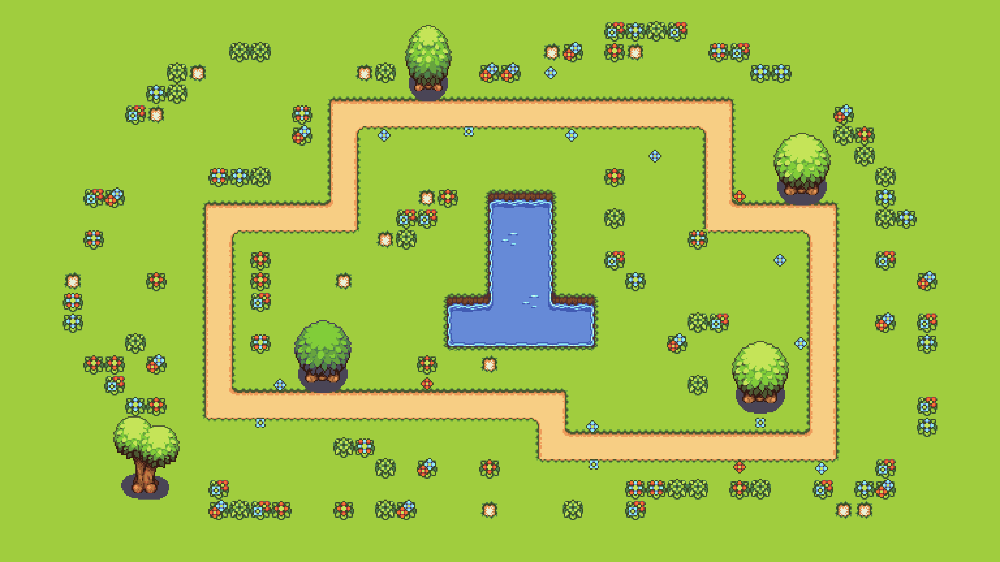

# 哈基米 · 打字竞速

让输入进度变成角色前进的距离，和朋友比拼打字速度。

  

---

## 项目亮点

- 哈基米与曼波角色动画，配合音乐与倒计时。
- 服务端提供比赛文本，客户端同步双方进度。
- 通过输入文字推动比赛，适合练习打字与盲打。
- 学习 HTTP 通信、线程、共享状态和图形界面的配合。

## 资源预览

以下为仓库内的地图与角色素材。

&nbsp;&nbsp;

## 本地运行

环境：Windows、Visual Studio C++、EasyX。HTTP 库已放在 `thirdparty/httplib.h`。

1. 打开 `hajimi666.slnx`，分别生成 `server1` 与 `client1` 项目。
2. 先运行服务端，确保其工作目录能读取 `server1/text.txt`。
3. 客户端从 `config.cfg` 读取地址，默认是 `localhost:25565`。
4. 在同一台电脑上打开两个客户端，等待双方加入后开始。
5. 客户端工作目录需包含 `config.cfg` 和 `resources/`。

**跨电脑联机：** 当前 `server1/server.cpp` 监听 `localhost`，仅支持本机连接。需要先将监听地址改为局域网地址或 `0.0.0.0`，再将两端客户端配置改为服务端的局域网 IP，例如 `192.168.1.10:25565`，并允许对应端口通信。以上步骤未在此次文档整理中重新编译验证。

## 自定义练习内容

修改 [server1/text.txt](./server1/text.txt) 后重启服务端。当前输入实现中，**打完一行还需要输入一个空格**；UTF-8 文本与 EasyX 字符处理尚有兼容细节，建议先用英文和简单文本验证。

## 代码导览

| 位置 | 职责 |
| --- | --- |
| `client1/cllient.cpp` | 客户端主流程、输入、通信与比赛阶段 |
| `client1/player_nodes.cpp` | 角色状态与动画 |
| `server1/server.cpp` | 加入比赛、读取文本与交换进度 |
| `server1/text.txt` | 练习文本 |
| `client1/config.cfg` | 服务端连接地址 |

角色与音频权利归各自权利人所有，使用前请确认相应授权。

---

如果你也在学习这个方向，欢迎通过 Issues 交流思路、反馈问题。遇到不理解的实现，可以结合代码与 AI 提问，先理解，再动手修改。
